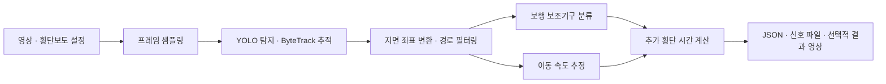

# Smart Crosswalk System

**보행자 추적과 보행 보조기구 분류를 바탕으로 횡단보도 신호 연장 시간을 추정하는 영상 분석 프로토타입.**

2024 Winter Ambient AI Boot Camp 팀 프로젝트의 Python 코드를 기능별 패키지로 정리했습니다.
보행자 탐지·추적 결과를 실제 지면 좌표로 변환하고, 이동 속도와 남은 거리를 이용해
추가 횡단 시간을 계산합니다. 원본의 두 YOLO 모델과 ByteTrack을 연결하는 추론 코드이며,
모델 학습 코드는 포함하지 않습니다.

## 처리 흐름



1. 설정한 간격으로 프레임을 읽고 동일한 크기의 영상에서 탐지와 분류용 crop을 만듭니다.
2. 보행자 ID별 바운딩 박스 하단 중심을 호모그래피로 지면 좌표에 투영합니다.
3. 관심 영역과 최소 관측 횟수로 경로를 필터링합니다.
4. ID별 crop을 균등하게 추출해 분류 확률을 평균합니다.
5. 지면 y좌표와 실제 경과 시간의 선형 회귀로 횡단 방향 속도를 추정합니다.
6. 판단 시점의 남은 거리와 녹색 신호 잔여 시간을 비교하고, 필요한 연장 시간을 올림합니다.

분류 클래스는 원본 코드 기준 `crutches`, `person`, `walking frame`, `walking stick`,
`wheelchair`입니다. 나이를 추정하는 모델은 아닙니다.

원본 분류 모델에 저장된 이름은 `0~4`입니다. `model_class_names`로 원시 레이블을 확인하고,
`class_names`로 원본 코드의 의미 매핑을 별도로 관리합니다.

## 빠른 시작: 모델 없는 예제

Python 3.11 이상을 사용합니다. 아래 설치는 사용자가 직접 수행하며 패키지 다운로드가 필요합니다.

```bash
python3 -m venv .venv
source .venv/bin/activate
python -m pip install -e .
smart-crosswalk demo
```

가상 경로에서 다음을 계산합니다. 모델의 성능을 평가하는 예제가 아닙니다.

| 항목 | 예제 값 |
|---|---:|
| 전체 녹색 신호 | 21초 |
| 판단 시점 | 시작 후 10초 |
| 남은 거리 | 750cm |
| 추정 속도 | 50cm/s |
| 필요한 횡단 시간 | 15초 |
| 남은 녹색 신호 | 11초 |
| **추가 시간** | **4초** |

결과는 `outputs/demo/summary.json`과 `outputs/demo/signal.txt`에 저장됩니다.
이동하지 않는 경로와 `person`으로 분류한 경로가 제외되는 이유도 JSON에서 확인할 수 있습니다.

## 원본 영상 분석

영상 추론 의존성은 별도로 설치합니다. 원본 환경의 버전 기록이 없어 이 범위의 모든 조합에서
모델 호환성이 검증된 것은 아닙니다.

```bash
python -m pip install -e ".[vision]"
```

로컬 파일을 다음 위치에 준비합니다. 이 파일들은 Git 추적 대상에서 제외됩니다.

```text
models/
├── human_detect.pt
└── classify.pt
data/videos/
└── test101_resized_4fps.mp4
```

```bash
# 설정 및 파일 존재 여부만 확인: 모델을 실행하지 않음
smart-crosswalk check --config configs/crosswalk.example.toml

# 기본 CPU 실행
smart-crosswalk analyze --config configs/crosswalk.example.toml

# 처리 간격·입력·출력 경로 변경 및 결과 영상 저장
smart-crosswalk analyze \
  --config configs/crosswalk.example.toml \
  --input data/videos/test101_resized_4fps.mp4 \
  --stride 2 \
  --output outputs/stride-2 \
  --save-video
```

`--detector`, `--classifier`, `--device`로 모델 경로나 추론 장치를 바꿀 수 있습니다.
기본 장치는 `cpu`이며, 환경에서 지원하면 `mps` 또는 `0` 등을 지정합니다.
설정 파일 내부의 상대 경로는 **설정 파일 위치**를 기준으로, 명령줄 경로는 **현재 작업 폴더**를
기준으로 해석합니다.

분석 결과:

- `summary.json`: 프레임 수, 추적 수, 속도·분류·연장 시간과 경로별 제외 이유
- `signal.txt`: `<track_id> <additional_time_s>` 형식. 예: `7 4`, 연장할 경로가 없으면 `None 0`
- `annotated.mp4`: `--save-video` 지정 시 판단 시점까지의 샘플 프레임에 ID·분류·속도 표시

영상 시작 시점이 보행 녹색 신호의 시작이라고 가정합니다. 다른 카메라 영상에는
그 카메라에 맞는 보정 좌표를 준비해야 합니다.

## 프로젝트 구조

```text
smart-crosswalk-system/
├── configs/crosswalk.example.toml   # 카메라 보정·신호·필터·분류 설정
├── src/smart_crosswalk/
│   ├── cli.py                     # 명령 해석과 실행 진입점
│   ├── config.py                  # 설정 로딩·검증
│   ├── types.py                   # 관측·탐지·판단 결과 자료형
│   ├── video.py                   # 영상 메타데이터·샘플링·crop
│   ├── backend.py                 # YOLO 모델 로딩·탐지·분류 어댑터
│   ├── geometry.py                # 호모그래피·지면 좌표 투영
│   ├── tracking.py                # 경로 필터·속도 추정
│   ├── classification.py          # crop 샘플링·분류 확률 집계
│   ├── timing.py                  # 신호 연장 시간 계산
│   ├── pipeline.py                # 분석 단계 연결
│   ├── visualization.py           # 결과 영상 출력
│   ├── reporting.py               # JSON·신호 파일 저장
│   └── demo.py                    # 가상 보행 데이터 예제
├── tests/                         # 모델 없는 로직·연결 검증
├── docs/architecture.md            # 함수별 역할과 계산 기준
├── docs/refactoring.md             # 원본 대응 관계·수정 내역
├── docs/verification.md            # 실제 검증 범위
├── docs/github-setup.md            # 사용자가 직접 GitHub에 올리는 순서
├── data/videos/README.md
├── models/README.md
├── .github/workflows/tests.yml
├── .gitignore
└── pyproject.toml
```

## 테스트

핵심 로직은 NumPy만으로 테스트할 수 있습니다. 카메라, 모델 파일, PyTorch가 필요하지 않습니다.

```bash
python -m unittest discover -s tests -v
```

이미 NumPy가 설치된 환경에서는 패키지를 설치하지 않고도 다음처럼 실행할 수 있습니다.

```bash
PYTHONPATH=src python -m unittest discover -s tests -v
PYTHONPATH=src python -m smart_crosswalk demo
```

GitHub Actions 설정은 Python 3.11·3.12에서 핵심 테스트와 가상 예제를 실행합니다.
실제 모델·영상은 GitHub Actions에서 실행하지 않습니다.

## 계산의 범위

이 저장소는 녹화 영상 기반의 연구용 프로토타입입니다. 실제 교통 신호 제어기와의 연동은
포함하지 않습니다. 신호 연장값은 보정 좌표, 일정 속도 가정과 분류 규칙에 의존합니다.

- 지면 좌표·거리는 cm, 속도는 cm/s, 시간은 초입니다. 목적지 방향을 y좌표 감소 방향으로 둡니다.
- `person` 확률이 0.9를 초과하면 일반 보행자로 제외하고, 나머지는 다른 클래스 중 최대 확률을
  선택하는 원본 규칙을 유지합니다. 이 규칙은 분류 오류를 만들 수 있습니다.
- 기본 속도 범위는 1~120cm/s이며, 최근 2초 이내 관측이 없는 경로는 제외합니다.
  정지·역방향·추적 실패 경로를 제외한 결과가 `0초`여도 모든 보행자가 안전하다는 뜻은 아닙니다.
- 판단 시점 이후의 영상은 추적·분류·속도 계산에 사용하지 않습니다.
- 현재 설정은 한 방향 횡단만 다루며 정량 정확도·오탐률·실시간 처리 성능은 재측정하지 않았습니다.

원본 발표자료와 모델·영상은 저장소에 포함하지 않습니다. 이 저장소는 팀 프로젝트의 코드를
재구성한 것이며 개인별 최초 구현 범위를 새로 주장하지 않습니다.

## 참고

- [Ultralytics Tracking](https://docs.ultralytics.com/modes/track/)
- [Ultralytics Prediction](https://docs.ultralytics.com/modes/predict/)
- [함수별 구조 설명](docs/architecture.md)
- [원본과 달라진 부분](docs/refactoring.md)
- [직접 GitHub에 올리기](docs/github-setup.md)
